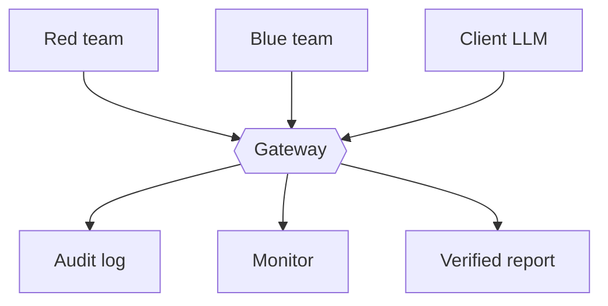

# Bayora-Aegis

Secure adversarial AI safety testing infrastructure. Hack in Hills '26, Problem 04.
Software-only project. Demo video: `<add link here>`

## Problem
Red team, blue team and the client LLM share one sandbox. If they can see each other's data, safety results are not trustworthy.

## Solution
They never talk directly. Everything goes through one gateway that provides:
- Signed access tokens and a deny-by-default policy
- Commit-reveal: blue sees red's attacks only after the test ends
- Identical replies and response time, so red cannot guess which defense fired
- A fresh model session per call, so nothing carries over
- A tamper-evident audit log (hash chain + HMAC)
- Per-team quotas and a metadata-only monitor

## Run (Python 3.9+, no installs)
    python bayora.py test           # 29 tests
    python bayora_ui.py             # dashboard at http://127.0.0.1:8000
    python bayora.py threat-model   # threat model
    python bayora.py emit-compose   # writes docker-compose.yml

## Files
- `bayora.py`: prototype and tests
- `bayora_ui.py`: live demo dashboard
- `docker-compose.yml`: hardened deployment design (one internal network per team)

## Hardware
Not applicable. Runs on any machine with Python 3.9+.

## Simulation and limits
- The client LLM is a deterministic mock.
- Isolation is enforced in code inside one process.
- `docker-compose.yml` is designed but not deployed.
- Not protected against: gateway compromise, container escape, hardware side channels.

## Real deployment plan
Separate rootless containers on internal networks, gVisor/Kata with seccomp, external audit anchoring, per-tenant GPU partitioning, confidential computing for the gateway.
